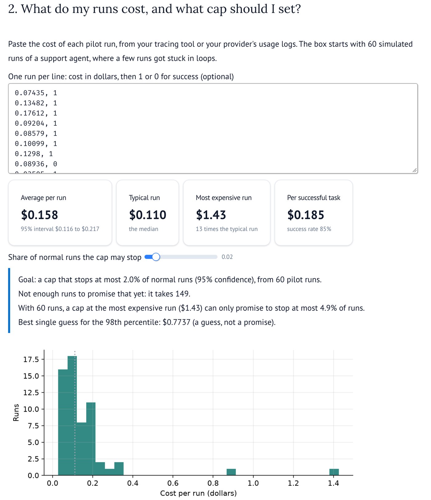

# costplan

**How much will my agent cost?** Plan AI agent budgets, caps and spend from a handful of pilot runs, with a [calculator that runs in your browser](https://ai-with-md.github.io/costplan/).

[](https://pypi.org/project/costplan/)
[](https://github.com/ai-with-md/costplan/actions/workflows/tests.yml)


[](https://ai-with-md.github.io/costplan/)

Agent costs are lopsided. Most runs take a few tool calls and cost a few cents. A few get stuck in a loop, retry, or read a long document, and cost ten times more. In the example pilot above, the typical run costs $0.11 and the most expensive one $1.43. That makes averages slow to settle, and it makes "what budget cap should I set?" a question about the rare expensive runs, not the typical ones.

costplan answers the planning questions from a pilot:

1. What does a run really cost, and what does a **finished task** cost?
2. What per-run budget cap should I set, so it almost never stops a normal run?
3. How many pilot runs do I need before I can trust those numbers?
4. What will it cost at 10,000 runs a day?
5. Is the cheaper model actually cheaper per finished task?

## The number most people get wrong

To set a budget cap that stops at most 2% of normal runs, and be 95% sure of it, you need **149 pilot runs**. Fewer runs simply cannot rule out a rare expensive run that a tighter cap would cut off. Set the cap at the most expensive pilot run and this is the best you can promise:

| Pilot runs | Cap stops at most |
|---|---|
| 20 | 13.9% of normal runs |
| 30 | 9.5% |
| 50 | 5.8% |
| 100 | 3.0% |
| 149 | 2.0% |
| 300 | 1.0% |

These numbers hold whatever the shape of your costs. costplan tells you what your current pilot can promise, and how many more runs the promise you want would take.

## Try it

**In the browser:** [ai-with-md.github.io/costplan](https://ai-with-md.github.io/costplan/). Paste your run costs, nothing to install.

**In Python:**

```bash
pip install costplan
```

No dependencies beyond the standard library. Python 3.9 or newer.

## Use

### Reading your exports

`load_runs` reads a CSV, JSON or JSON Lines export from your tracing tool or provider and finds the cost, token, success and run columns by their common names (`cost`, `total_cost`, `totalCost`, `calculatedTotalCost`, `prompt_tokens`, `input_tokens`, `usage.input`, `status`, `error`, `trace_id`, `traceId` and others).

```python
import costplan as cp

runs = cp.load_runs("calls_export.jsonl", group_by="trace_id")
print(runs.report())
# Read 318 rows into 40 runs (cost from 'cost', status from 'status', runs from 'trace_id').

costs, successes = runs.costs, runs.successes
```

- **One row per model call?** Pass `group_by` with the column that names the run (a trace or session id). Calls are added up into runs, and a run counts as failed if any of its calls failed.
- **One row per run, already totalled?** Load it as it is. Grouping it again would count costs twice.
- **No cost column, or calls your tool could not price?** Pass `input_price` and `output_price` in dollars per million tokens and costplan prices them from the token columns. costplan ships no price table, because prices change; take them from your provider's pricing page or a list such as [tokencost](https://github.com/AgentOps-AI/tokencost).
- **Names not found?** Pass them yourself: `cost="spend"`, `success="passed"`, and dotted names for nested JSON such as `"usage.prompt_tokens"`.

The column guesses are tested on files shaped like LangSmith run exports and Langfuse observation exports, using the field names in their documentation. Check `runs.report()` the first time you load a new kind of file.

`run_cost` does the same pricing for a single call:

```python
cp.run_cost(input_tokens=12_000, output_tokens=800, input_price=3.0, output_price=15.0)
# 0.048
```

### 1. What does a run cost?

```python
print(cp.summarize(costs, successes))
# 60 runs.
#   Average cost per run: $0.1577 (95% interval $0.1160 to $0.2167)
#   Typical run (median): $0.1100 (95% interval $0.0920 to $0.1371)
#   1 in 20 runs costs more than: $0.3272 (95% interval needs more runs)
#   Most expensive run: $1.43
#   Success rate: 85.0% (95% interval 73.9% to 91.9%)
#   Cost per successful task: $0.1855 (95% interval $0.1308 to $0.2677)
```

The cost per successful task is the number that matters for a product: failed runs cost money too.

### 2. What cap should I set?

```python
print(cp.recommend_cap(costs, stop_rate=0.02))
# Goal: a cap that stops at most 2.0% of normal runs (95% confidence), from 60 pilot runs.
#   Not enough runs to promise that yet: it takes 149.
#   With 60 runs, a cap at the most expensive run ($1.43) can only promise to stop at most 4.9% of runs.
#   Best single guess for the 98th percentile: $0.7737 (a guess, not a promise).
```

With enough runs, it returns a recommended cap. That cap is an upper confidence bound on the cost percentile, so it holds even if the pilot happened to miss some expensive runs. Enforce it with your agent framework, your own code, or a library such as [AgentBudget](https://github.com/AgentBudget/agentbudget).

### 3. How many pilot runs do I need?

```python
cp.runs_needed_for_cap(stop_rate=0.02)       # 149
cp.guaranteed_stop_rate(n_runs=30)           # 0.095
cp.pilot_runs_for_average(spread=1.0, margin=0.10)   # 385 runs to pin the average within 10%
```

`spread` is the standard deviation divided by the average. Agent costs often have a spread near 1 or above because of the runaway runs, which is why averages need hundreds of runs to settle.

### 4. What will it cost at scale?

```python
print(cp.project_spend(costs, runs=300_000))
# 300,000 runs: about $47,301.75 (95% range $31,765.55 to $62,837.95).
```

At high volume the run to run variation averages out, and nearly all of the range comes from how well the pilot pinned down the average. A bigger pilot narrows it more than anything else.

### 5. Is the cheaper model cheaper per finished task?

```python
print(cp.compare_cost_per_success(large_costs, large_ok, small_costs, small_ok, names=("large model", "small model")))
# Cost per successful task: large model $0.1855, small model $0.2197.
#   small model costs 1.18 times as much as large model per success (95% interval 0.71 to 2.02, separate pilots). The difference could be noise.
```

In this example the small model is about 30% cheaper per run, but it fails and loops more often, so it probably costs more per finished task. With 60 runs each, costplan correctly says the difference is not yet certain.

**Run both models on the same tasks if you can.** Hard tasks are expensive for every model, so comparing task by task removes that variation. With `paired=True` the same 60 tasks give an answer that separate pilots cannot:

```python
cp.compare_cost_per_success(large_costs, large_ok, small_costs, small_ok, names=("large model", "small model"))
#   small model costs 0.73 times as much as large model per success (95% interval 0.49 to 1.08, separate pilots). The difference could be noise.

cp.compare_cost_per_success(large_costs, large_ok, small_costs, small_ok, names=("large model", "small model"), paired=True)
#   small model costs 0.73 times as much as large model per success (95% interval 0.61 to 0.88, same tasks, compared task by task). small model is reliably cheaper per success.
```

In simulation, pairing gives intervals about half as wide from the same number of runs.

## Command line

```bash
costplan summary runs.csv
costplan cap     runs.csv --stop-rate 0.02
costplan project runs.csv --runs 300000
costplan compare large.csv small.csv --names "large model" "small model"
costplan compare large.csv small.csv --paired --task-column task_id
costplan summary calls_export.jsonl --group-by trace_id -v
costplan pilot   --stop-rate 0.02 --spread 1.0
```

Files can be CSV, JSON or JSON Lines, with the same automatic column finding as `load_runs`. Use `--cost-column`, `--success-column` and similar options when the guess is wrong, `--input-price` and `--output-price` for files with tokens but no costs, and `-v` to see which columns were used. Try it on the simulated files in [`examples/`](https://github.com/ai-with-md/costplan/tree/main/examples).

## How the numbers are checked

The test suite simulates thousands of pilots with lopsided costs where the truth is known, and checks each promise:

| Promise | Held in simulation |
|---|---|
| The recommended cap stops at most 2% of runs | 98.5% of pilots (95% promised) |
| A cap at the most expensive of 149 runs stops at most 2% | 94.8% |
| The interval for cost per successful task covers the truth | 93% |
| The spend projection covers the real bill | 92% |
| The interval for the average cost covers the truth | 92% |
| The paired comparison interval covers the true ratio | 96% |
| Paired vs separate pilots, same number of runs | interval about half as wide |

The caps and quantiles make no assumption about the shape of costs and keep their promise. The intervals for averages run slightly short of 95% on lopsided costs, which is typical for the bootstrap; treat them as a little optimistic, especially below about 30 runs. See [`tests/test_simulation.py`](https://github.com/ai-with-md/costplan/blob/main/tests/test_simulation.py).

## How it compares

- **[AgentBudget](https://github.com/AgentBudget/agentbudget)** and similar tools enforce a dollar limit while an agent runs. costplan tells you what limit to set, and what you will spend. They work well together.
- **Price calculators and price lists** such as [tokencost](https://github.com/AgentOps-AI/tokencost) cost out a single request. costplan works on whole runs, including the expensive tail, retries and failures.
- **Tracing tools** (Langfuse, LangSmith and others) record what runs cost. costplan turns those records into planning numbers with honest uncertainty.

## Limits

- The pilot must look like real traffic: the same prompts, tools, models and mix of requests. Change any of them and run a new pilot.
- Caps and projections assume future runs behave like pilot runs. A new kind of request that triggers long loops will not show up in a pilot that never saw it.
- The spend projection uses a normal approximation, which is a little narrow for very lopsided costs.

## More tools

Small, free tools for building and checking AI systems:

- **[sturdytools](https://github.com/ai-with-md/sturdytools)**: retries, timeouts, rate limits and circuit breakers for the tools an AI agent calls.
- **[evalsize](https://github.com/ai-with-md/evalsize)**: how many eval examples you need before a difference between prompts or models means anything.
- **[evalnoise](https://github.com/ai-with-md/evalnoise)**: where the noise in an eval score comes from (questions, judges, prompt wordings, reruns), and where to spend the next API calls.
- **[rolloutwatch](https://github.com/ai-with-md/rolloutwatch)**: whether a prompt or model change made quality worse, checking as often as you like without false alarms.

## Development

```bash
python -m venv .venv
source .venv/bin/activate
pip install -e ".[dev]"
pytest
```

The calculator is a [marimo](https://marimo.io) notebook in [`app/calculator.py`](https://github.com/ai-with-md/costplan/blob/main/app/calculator.py), published to GitHub Pages as a WebAssembly app on every push to `main`.

## License

MIT
